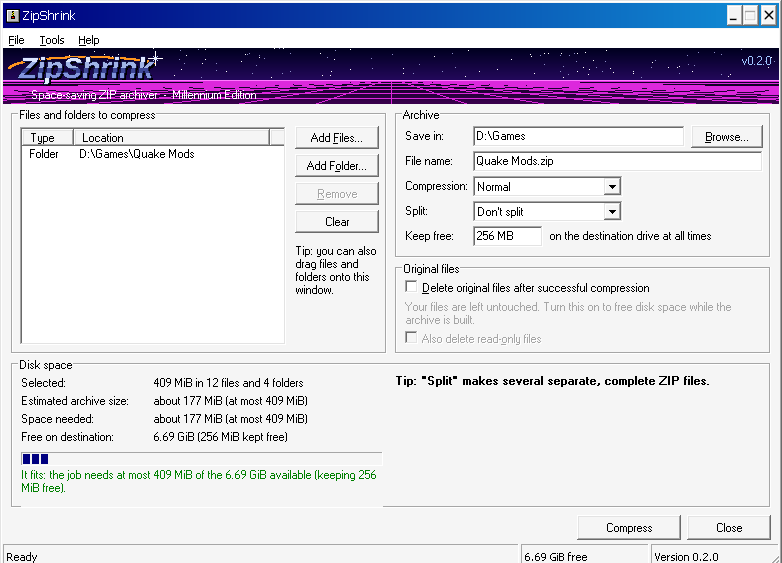
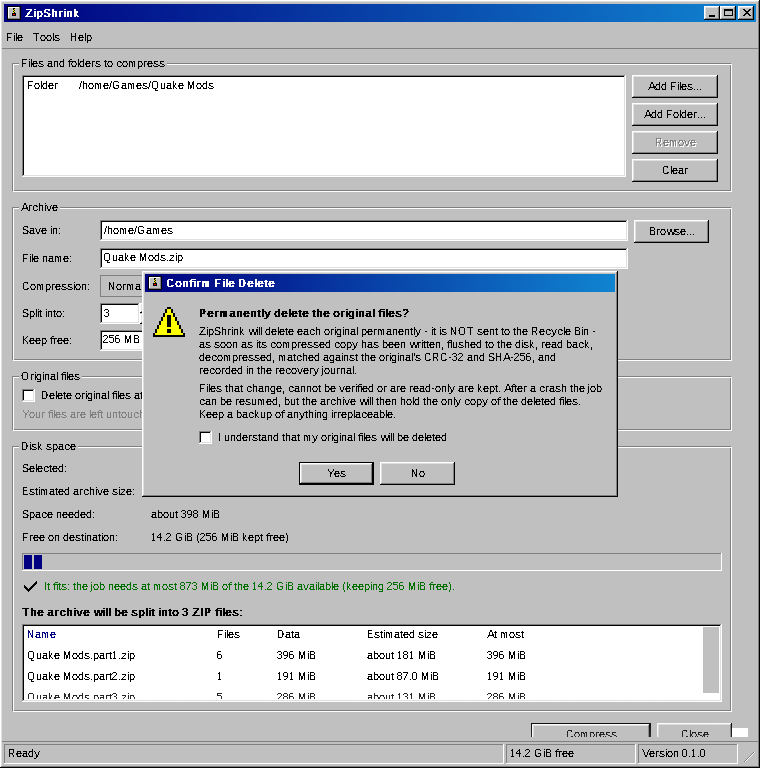
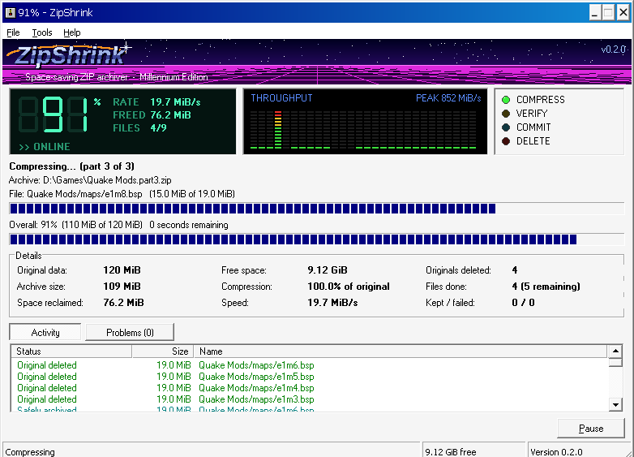
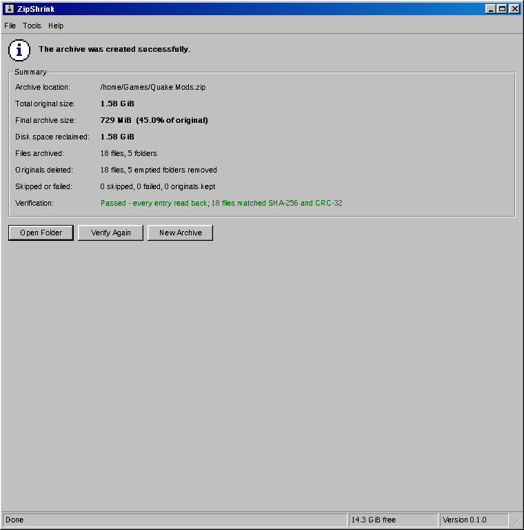
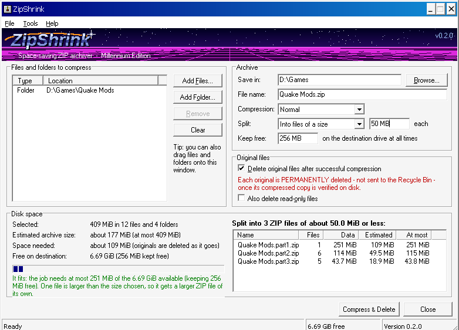

# ZipShrink

**Compress a folder into a ZIP without needing room for both.**

ZipShrink creates standard ZIP archives and, if you ask it to, deletes each
original file as soon as its compressed copy has been written to disk, read
back, and proven identical. The space the originals used is reclaimed while
the archive grows, so zipping a 200 GB folder needs a little over the space
of one file, not another 200 GB.

It is a free, open-source Windows program and command-line tool that runs on
**every 32- and 64-bit Windows from Windows 95 to Windows 11**. It looks like
it shipped in 1998, with the "futuristic" Millennium touches of 1999–2001 —
and since version 0.2 it really could have: it is written in C against the
Win32 API of 1995, with no runtime library, and the same two small programs
run on a Pentium with Windows 95 and on a current Windows 11 PC. Underneath
the look it is a crash-safe, fully verified archiver.



> ZipShrink is an independent project. It does the reverse of what
> [HatchZip](https://hatchzip.dev) does (HatchZip extracts archives in place)
> and is not affiliated with HatchZip or its author.

## Contents

- [Why](#why)
- [How it works](#how-it-works)
- [Is it safe?](#is-it-safe)
- [Install](#install)
- [Supported Windows versions](#supported-windows-versions)
- [Using the app](#using-the-app)
- [Using the command line](#using-the-command-line)
- [Splitting into several ZIPs](#splitting-into-several-zips)
- [If something goes wrong](#if-something-goes-wrong)
- [Updates](#updates)
- [Limitations](#limitations)
- [Building from source](#building-from-source)
- [Documentation](#documentation)
- [License](#license)

## Why

A normal ZIP tool reads your files and writes the archive next to them. Until
it finishes, the disk holds the originals **and** the archive. On a nearly full
disk that is impossible, and the usual workaround — zip to another drive, then
copy back — needs a second drive.

ZipShrink processes files in small batches and frees each batch's originals as
soon as they are safely in the archive:

| Folder size | Typical ZIP tool needs | ZipShrink with deletion needs |
|---|---|---|
| 200 GB of game files that compress to 150 GB | 150 GB free | about the size of the largest file, plus a small reserve |

## How it works

For every batch of files (at most 64 MB of data, 1,024 files or 3 seconds;
a large file is a batch of its own), ZipShrink:

1. opens each file without following links, through a handle that stops other
   programs from writing to it while it is read;
2. reads it once, computing its **CRC-32** and **SHA-256** while compressing
   it (Deflate) onto the end of `NAME.zip.partial`;
3. checks the file did not change while it was read (size, modification time,
   and on Windows NT-family systems its volume and file id); if it did, it
   re-reads it;
4. **flushes** the archive to the storage device (`FlushFileBuffers`);
5. **reads every entry back** — on Windows NT, 2000, XP and later through a
   second handle that bypasses the file cache — compares the header bytes,
   decompresses the data and compares the result with the CRC-32 and SHA-256
   taken from the original;
6. records the batch in a **durable recovery journal**
   (`NAME.zip.partial.journal`, flushed to disk);
7. only then, if deletion is on, checks each original once more — same size,
   times and file id, and by default the same SHA-256 by re-reading it — and
   **permanently deletes it**. On the NT family the check and the delete
   happen through one handle that keeps writers out, so nothing can change or
   swap the file in between.

When every file is done, ZipShrink writes the ZIP central directory, reads
the whole archive back (every entry decompressed, CRC-32 and SHA-256 checked;
every central-directory record compared with the journal), renames
`NAME.zip.partial` to `NAME.zip`, and removes the folders that were emptied.

Archives are plain ZIP (ZIP64 when files or archives exceed 4 GB or 65,535
entries) and open in Windows Explorer, 7-Zip, WinZip, WinRAR, Info-ZIP
`unzip`, macOS Archive Utility and every other ZIP tool. ZipShrink stores each
file's SHA-256 in an extra field that other tools ignore, so `zipshrink verify`
can check archives it made far more strictly than CRC-32 alone.

## Is it safe?

Deleting originals is the point of the tool, so it is built around never
deleting anything it cannot prove is safely archived.

- **Deletion is off by default.** In the app you must tick the option and
  confirm a warning (with an "I understand" box); on the command line you must
  pass `--delete-originals` and type `delete` at the prompt (unless you add
  `--yes`).
- **Nothing is deleted on the strength of a memory buffer.** Data must be on
  the disk, read back, decompressed and matched by two checksums, and the
  journal must be on the disk, before the original is touched.
- **Changed files are kept.** A file modified after it was compressed is not
  deleted; the archive holds the version that was verified.
- **Links are never followed.** Junctions, symbolic links and other reparse
  points (including OneDrive placeholders) are skipped and left in place.
  Nothing outside the folders you selected is read or deleted.
- **Read-only files are kept** unless you allow them to be deleted.
- **Crashes, power cuts and full disks are survivable.** Everything committed
  stays in the partial archive; `resume` cuts off any half-written entry and
  carries on. Temporary archives and journals are never deleted after a
  failure.
- **A damaged partial archive stops all deletion.** Before deleting anything
  on resume, ZipShrink re-verifies the archived copy. If anything does not
  match, it stops and tells you how to recover.
- **The disk is never filled.** You choose a free-space reserve (256 MB by
  default, never below 16 MB); ZipShrink pauses safely before crossing it.
- **Existing archives are never overwritten** without confirmation, and even
  then only once the new archive is complete and verified.

These guarantees are tested: the test suite kills the real program at 17
points (before and after the journal commit, before, during and after a
deletion, during finalization and rename, with a torn journal write), injects
disk-full and I/O errors, damages journals and partial archives, then resumes
and checks with an independent ZIP reader that every original is either still
present unchanged or in the final archive with an identical SHA-256. The suite
runs on Windows and, under Wine, in both Windows 10 and Windows 95 modes.

**Still: deleted originals are gone.** After the job, the archive is the only
copy. Keep backups of anything irreplaceable, and do not use deletion on
storage you suspect is failing. See [docs/DATA_SAFETY.md](docs/DATA_SAFETY.md)
for the full design and its limits — including what is weaker on Windows
95, 98 and Me.

## Install

From the [latest release](https://github.com/knivesbatz/zipshrink/releases/latest):

| File | What it is |
|---|---|
| `ZipShrink-setup.exe` | Installer for Windows 95 through 11. On Windows 2000 and later it installs for your user account (no administrator rights needed); on 95, 98, Me and NT 4 it installs into Program Files. Adds a Start menu entry, an optional "Compress with ZipShrink…" right-click menu, and (2000 and later) the `zipshrink` command. |
| `ZipShrink.msi` | The same programs as a per-machine Windows Installer package, for IT deployment: `msiexec /i ZipShrink.msi /qn`. Needs Windows Installer 2.0 or later (built into Me, 2000 SP3, XP and later; a free download for 95, 98 and NT 4). |

The programs are not code-signed yet, so Windows SmartScreen may say "Windows
protected your PC": choose **More info**, then **Run anyway**. Every release
lists SHA-256 checksums in `SHA256SUMS`.

Upgrading from 0.1.x: download and run the new setup (0.1's built-in
updater does not find 0.2); it installs into the same folder.
Unfinished jobs started by 0.1.x must be finished with 0.1.x (the journal
format changed). macOS and Linux builds were dropped in 0.2; ZipShrink 0.1.0's
source code remains in the repository history for them.

## Supported Windows versions

| Windows | Status |
|---|---|
| 10 and 11 (x64, x86, Arm64 through emulation) | Supported; tested in CI on Windows Server 2022/2025 runners. |
| Vista, 7, 8, 8.1 | Supported (same code paths as 10 and 11). |
| 2000, XP, Server 2003 | Supported. |
| NT 4.0 | Supported, except downloading updates (see below). |
| 95, 98, Me | Supported, with the differences below. Tested with Wine in Windows 95 mode; not tested on real hardware. |

Differences on Windows 95, 98 and Me, which have no Unicode file API:

- File names must be representable in the system code page (for example
  Windows-1252 in Western Europe). Files whose names are not are skipped,
  reported, and left in place — never guessed at.
- Paths are limited to 260 characters (the NT family handles longer paths).
- Reading back after the flush goes through the file cache; the NT family
  bypasses it.
- Before deleting, ZipShrink re-reads and hashes the original while holding a
  handle that keeps writers out, then closes it, re-checks size and time, and
  deletes it by name. The NT family checks and deletes through one handle.
  See [DATA_SAFETY.md](docs/DATA_SAFETY.md#windows-95-98-and-me).
- FAT16 and FAT32 cannot hold files of 4 GB or more; the space check warns,
  and `--part-size 4000M` keeps each archive smaller.
- **Updates cannot be downloaded** (on NT 4 either): GitHub requires TLS 1.2,
  which these systems cannot speak. ZipShrink tells you so; get new versions
  from another computer.

The main window is about 780 × 560 pixels and needs an 800 × 600 screen.

## Using the app

1. Drag files and folders onto the window, or use **Add Folder…** / **Add Files…**.
2. Choose where to save the archive, its name, the compression level, and
   optionally **Split** it into several ZIPs: into a number of files, or
   into files of a size you choose (for example 650 MB each).
3. Tick **Delete original files after successful compression** if you want
   the space back as you go.
4. Check the **Disk space** box: it shows the estimated archive size (from
   compressing samples of your files), how much space the job needs, how much
   is free, and whether it fits.
5. Click **Compress** (or **Compress & Delete**, which asks you to confirm).



While it runs, a millennium-style control panel shows live readings: a
seven-segment LCD with the overall percentage, transfer rate, space freed and
files done; a segmented throughput meter (one bar per quarter second, with the
peak rate); and activity lights that flash as files are actually compressed,
verified, committed to the journal and deleted. Below it you see the current
file, overall progress and time remaining, archive size, free space, space
reclaimed, compression ratio, speed, and a list of every file as it is
archived and deleted (problems have their own list). **Pause** stops at the
next safe point; you can resume later, even after closing the app.



When it finishes you get the archive location, original and final sizes, space
reclaimed, files archived, originals deleted, anything skipped or kept and why,
and the verification result, with **Open Folder** and **Verify Again**.



**File** also has **Resume Unfinished Job…**, **Verify Archive…** and
**Salvage Partial Archive…**.

## Using the command line

```
zipshrink create GameFiles -o GameFiles.zip
zipshrink create GameFiles -o GameFiles.zip --delete-originals
zipshrink check  GameFiles -o GameFiles.zip          (changes nothing)
zipshrink resume GameFiles.zip.partial
zipshrink verify GameFiles.zip
```

Options for `create` (`zipshrink --help` lists them all):

| Option | Meaning |
|---|---|
| `-l, --level 0-9` | 0 stores, 1 fastest, 6 default, 9 smallest |
| `-p, --parts N` | split into N separate ZIP files of about equal size |
| `-s, --part-size SIZE` | split into separate ZIP files of about SIZE each, e.g. `650M` or `2G` |
| `--delete-originals` | delete each original after it is verified (asks to confirm; `-y` skips the question) |
| `--min-free SIZE` | free space to keep on the destination, e.g. `2G` (default `256M`) |
| `--quick-change-check` | before deleting, compare size, times and file id instead of re-reading the whole file |
| `--delete-readonly` | also delete read-only files |
| `--overwrite` | replace an existing archive (only after the new one is verified) |
| `--no-final-verify` | skip decompressing the finished archive again (each entry is still verified when written) |
| `--ignore-space-check` | start even if the space check says it may not fit (it pauses safely if space runs out) |
| `-q`, `-v` | print only the summary and problems / list every file |

Other commands: `status` shows what an unfinished job holds; `salvage`
rebuilds a readable ZIP from a `.partial` file whose journal is lost or
damaged; `update` checks for and installs a newer version.

Exit codes: `0` success · `1` error · `2` bad command line · `3` finished but
some files were skipped, failed or kept · `4` not enough disk space · `5`
interrupted (resumable) · `6` verification failed · `7` partial archive or
journal damaged.

## Splitting into several ZIPs

Choose **Split** in the app, or use the command line, to produce
`NAME.part1.zip`, `NAME.part2.zip`, … in one of two ways:

- **Into a number of files** (`--parts N`): N parts of about equal size.
- **Into files of a size** (`--part-size SIZE`): you give the size of each
  ZIP, such as `650 MB` or `2 GB`, and ZipShrink works out how many parts are
  needed. It fills each part in order until the next file would take its
  estimated compressed size over the limit. If everything fits in one ZIP of
  that size, nothing is split.

Before starting, ZipShrink shows the number of files, the data, and the
estimated and maximum size of every part.



Each part is a **complete, independent ZIP** — not a spanned `.z01` set — so
each opens on its own, and extracting all of them into one folder rebuilds the
original tree. Files are divided in order at file boundaries so the parts are
as even as possible, or as full as the chosen size allows; a single file is
never cut in two, so a file larger than the chosen size gets a ZIP of its
own, and that ZIP is larger.

The size limit uses the same estimate as the space check, measured by
compressing samples of your files. Files that compress less well than the
samples can make a part a little larger than the size chosen. The **At most**
column shows the largest each part can be. Every part is its own crash-safe job, and `resume`
continues all unfinished parts of a set.

## If something goes wrong

- **The program or computer crashed, or you paused:** start ZipShrink and
  choose **File → Resume Unfinished Job…** (or open the `.partial` file with
  it), or run `zipshrink resume NAME.zip.partial`.
- **The disk filled up / reached the reserve:** free some space (or lower the
  reserve with `--min-free`) and resume.
- **ZipShrink says the partial archive or journal is damaged:** it has stopped
  deleting. Keep both files. `zipshrink status NAME.zip.partial` shows what
  they hold; **File → Salvage** or `zipshrink salvage NAME.zip.partial`
  rebuilds a readable ZIP from every intact entry (each checked by CRC-32 and
  SHA-256).

## Updates

The app checks GitHub for a newer release at most once a day (turn this off
under **Tools → Check for Updates at Startup**); it only mentions a new
version in the status bar. It never installs anything by itself: when you
choose **Tools → Check for Updates…** and agree, it downloads the installer,
checks its SHA-256 against the `SHA256SUMS` file published with the release,
and runs it. From the command
line: `zipshrink update` (or `zipshrink update --check`). Updates are never
installed while a job is running. Windows 95/98/Me and NT 4 cannot reach
GitHub (see above).

## Limitations

See [docs/FORMATS_AND_LIMITATIONS.md](docs/FORMATS_AND_LIMITATIONS.md). In short:
output is ZIP with Deflate or Store (no encryption, no 7z/zstd); NTFS
alternate data streams, ACLs and extended attributes are not stored; links are
skipped; FAT destinations cannot hold archives of 4 GB or more; compression
uses one processor core; Windows only.

## Building from source

ZipShrink is plain C99 built with MinGW-w64's 32-bit compiler, from Linux or
from Windows (MSYS2):

```
make                      # build/zipshrink.exe and build/zipshrink-gui.exe
make test                 # the test suite (Windows, or Wine elsewhere)
make check-imports        # every imported function exists on Windows 95
packaging/build-windows.sh   # installer and MSI in dist/
```

See [docs/BUILDING.md](docs/BUILDING.md).

## Documentation

- [docs/ARCHITECTURE.md](docs/ARCHITECTURE.md) — modules, on-disk formats, transaction design, Windows 95 compatibility
- [docs/DATA_SAFETY.md](docs/DATA_SAFETY.md) — guarantees, failure handling, what is and is not protected
- [docs/FORMATS_AND_LIMITATIONS.md](docs/FORMATS_AND_LIMITATIONS.md)
- [docs/BUILDING.md](docs/BUILDING.md)
- [THIRD_PARTY_LICENSES.md](THIRD_PARTY_LICENSES.md)

## License

MIT — see [LICENSE](LICENSE). The only third-party code, miniz's deflate and
inflate, is also MIT licensed; see [THIRD_PARTY_LICENSES.md](THIRD_PARTY_LICENSES.md).
