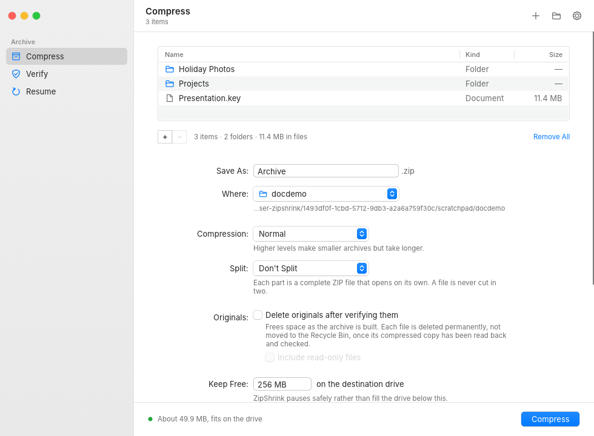
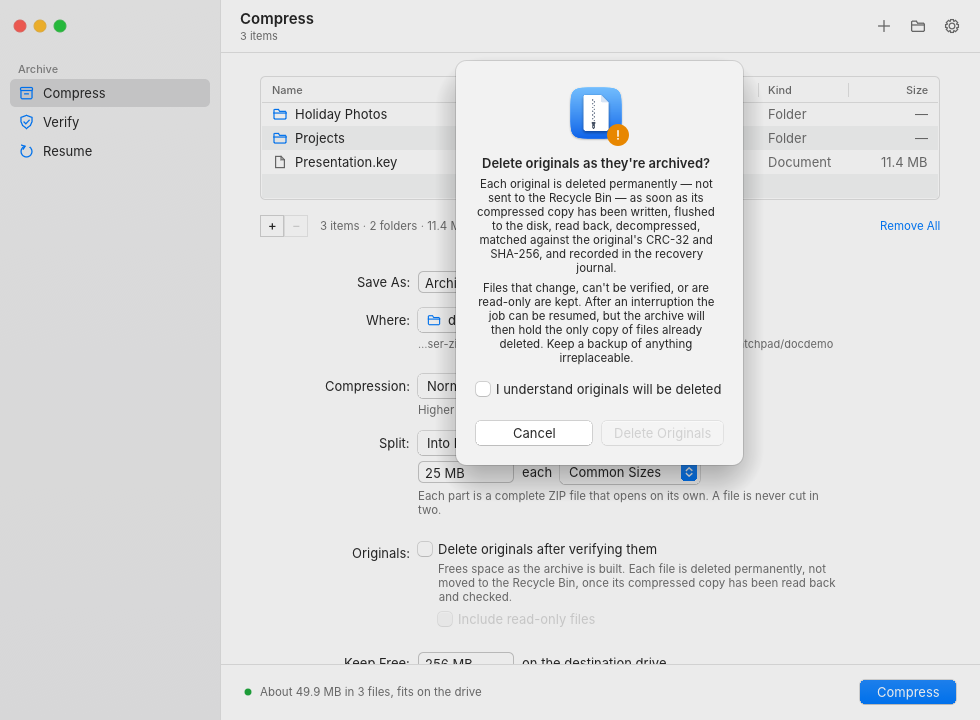
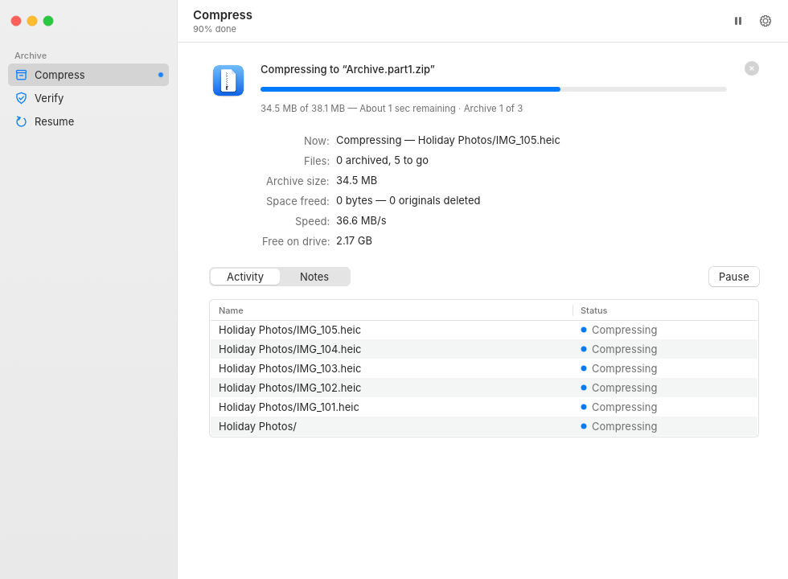
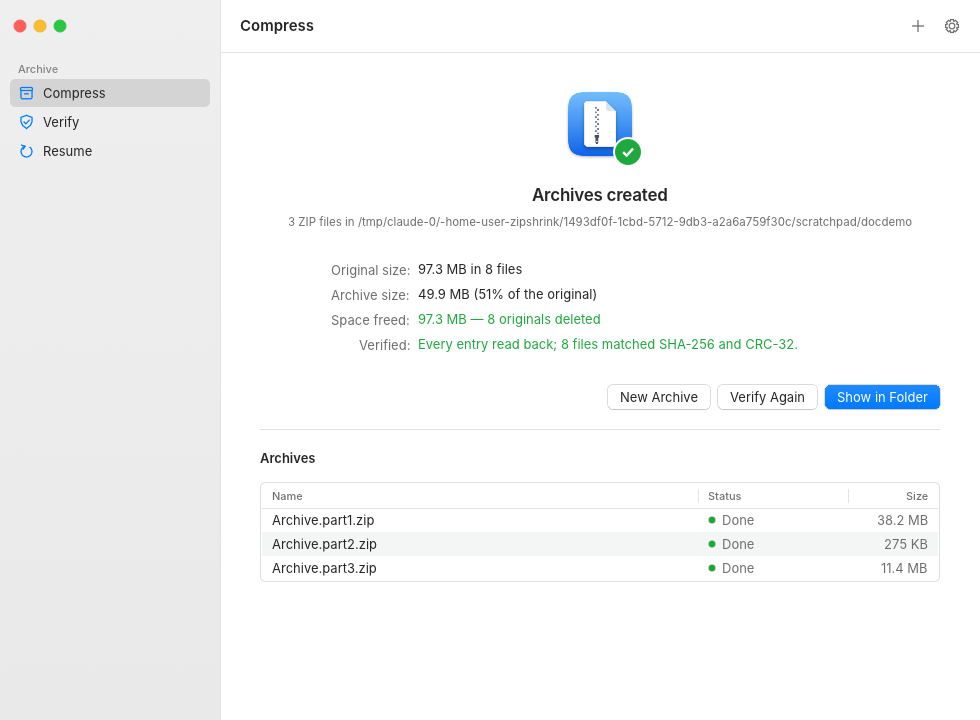
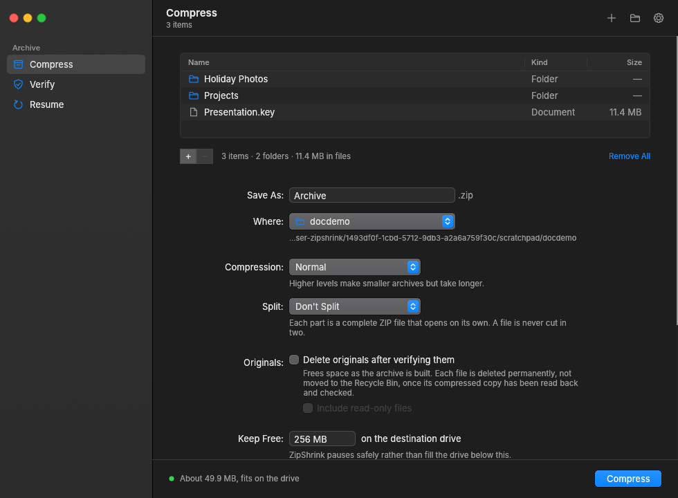
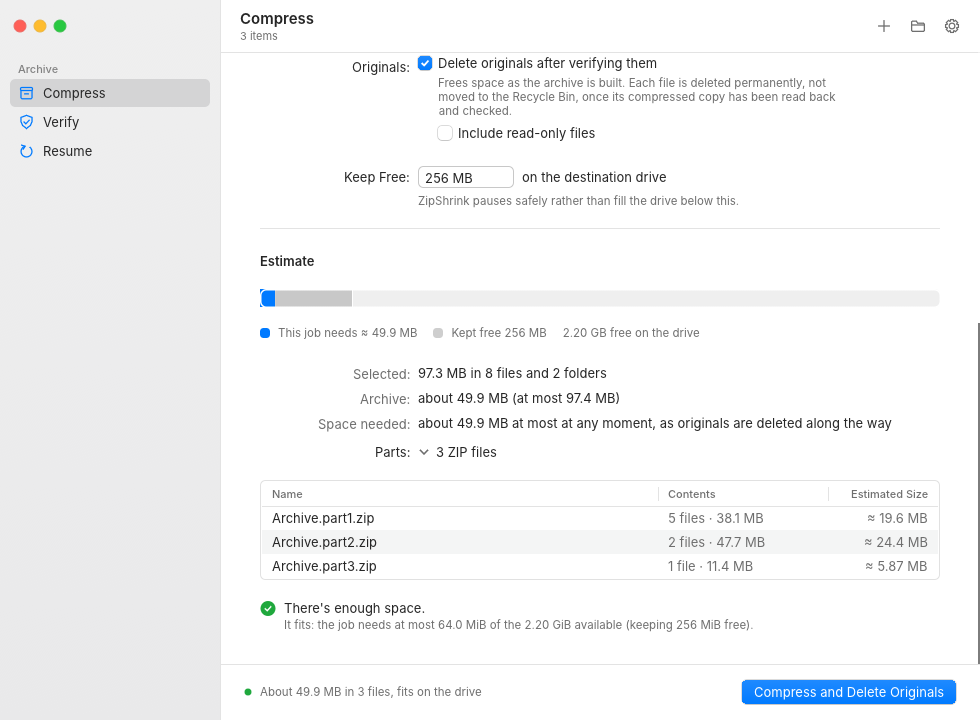

# ZipShrink

**Compress a folder into a ZIP without needing room for both.**

ZipShrink creates standard ZIP archives and, if you ask it to, deletes each
original file as soon as its compressed copy has been written to disk, read
back, and proven identical. The space the originals used is reclaimed while
the archive grows, so zipping a 200 GB folder needs a little over the space
of one file, not another 200 GB.

It is a free, open-source desktop app and command-line tool for **64-bit
Windows 10 and 11** and **macOS 11 Big Sur or later** (Apple silicon and
Intel), written in Rust. It has a modern interface with light and dark
appearance, comes as one installer on Windows and one app to drag into
Applications on a Mac, and keeps itself up to date. Underneath it is a
crash-safe, fully verified archiver.



> ZipShrink is an independent project. It does the reverse of what
> [HatchZip](https://hatchzip.dev) does (HatchZip extracts archives in place)
> and is not affiliated with HatchZip or its author.

## Contents

- [Why](#why)
- [How it works](#how-it-works)
- [Is it safe?](#is-it-safe)
- [Install](#install)
- [Install on a Mac](#install-on-a-mac)
- [Using the app](#using-the-app)
- [Using the command line](#using-the-command-line)
- [Splitting into several ZIPs](#splitting-into-several-zips)
- [If something goes wrong](#if-something-goes-wrong)
- [Updates](#updates)
- [Limitations](#limitations)
- [Building from source](#building-from-source)
- [Documentation](#documentation)
- [License](#license)

## Why

A normal ZIP tool reads your files and writes the archive next to them. Until
it finishes, the disk holds the originals **and** the archive. On a nearly full
disk that is impossible, and the usual workaround — zip to another drive, then
copy back — needs a second drive.

ZipShrink processes files in small batches and frees each batch's originals as
soon as they are safely in the archive:

| Folder size | Typical ZIP tool needs | ZipShrink with deletion needs |
|---|---|---|
| 200 GB of game files that compress to 150 GB | 150 GB free | about the size of the largest file, plus a small reserve |

## How it works

For every batch of files (at most 64 MB of data, 1,024 files or 3 seconds;
a large file is a batch of its own), ZipShrink:

1. opens each file without following links, through a handle that stops other
   programs from writing to it while it is read;
2. reads it once, computing its **CRC-32** and **SHA-256** while compressing
   it (Deflate) onto the end of `NAME.zip.partial`;
3. checks the file did not change while it was read (size, modification and
   change time, volume and file id); if it did, it re-reads it;
4. **flushes** the archive to the storage device (`FlushFileBuffers` on
   Windows, `F_FULLFSYNC` on a Mac);
5. **reads every entry back** through a second handle that bypasses the file
   cache, compares the header bytes, decompresses the data and compares the
   result with the CRC-32 and SHA-256 taken from the original (on a Mac the
   cached copy is dropped first; where macOS does not allow that, the report
   says the check was read from the cache);
6. records the batch in a **durable recovery journal**
   (`NAME.zip.partial.journal`, flushed to disk);
7. only then, if deletion is on, checks each original once more — same size,
   times and file id, and by default the same SHA-256 by re-reading it — and
   **permanently deletes it**. The check and the delete happen through one
   handle that keeps writers out, so nothing can change or swap the file in
   between.

When every file is done, ZipShrink writes the ZIP central directory, reads
the whole archive back (every entry decompressed, CRC-32 and SHA-256 checked;
every central-directory record compared with the journal, and the archive
read again with an independent ZIP reader), renames
`NAME.zip.partial` to `NAME.zip`, and removes the folders that were emptied.

Archives are plain ZIP (ZIP64 when files or archives exceed 4 GB or 65,535
entries) and open in Windows Explorer, the Finder (Archive Utility), 7-Zip,
WinZip, WinRAR, Info-ZIP `unzip` and every other ZIP tool. ZipShrink stores each
file's SHA-256 in an extra field that other tools ignore, so `zipshrink verify`
can check archives it made far more strictly than CRC-32 alone.

## Is it safe?

Deleting originals is the point of the tool, so it is built around never
deleting anything it cannot prove is safely archived.

- **Deletion is off by default.** In the app you must tick the option and
  confirm a warning (with an "I understand" box); on the command line you must
  pass `--delete-originals` and type `delete` at the prompt (unless you add
  `--yes`).
- **Nothing is deleted on the strength of a memory buffer.** Data must be on
  the disk, read back, decompressed and matched by two checksums, and the
  journal must be on the disk, before the original is touched.
- **Changed files are kept.** A file modified after it was compressed is not
  deleted; the archive holds the version that was verified.
- **Links are never followed.** Junctions, symbolic links and other reparse
  points (including OneDrive placeholders) are skipped and left in place, as
  are, on a Mac, iCloud Drive files that are not downloaded and other disks
  mounted inside a selected folder. Nothing outside the folders you selected
  is read or deleted.
- **Read-only files are kept** unless you allow them to be deleted (on a
  Mac, so are files locked in the Finder).
- **What a ZIP cannot hold is not thrown away.** On a Mac, a file or folder
  that carries Finder tags, a Finder comment, a resource fork or similar
  macOS metadata is archived but not deleted, and the report says why.
- **Crashes, power cuts and full disks are survivable.** Everything committed
  stays in the partial archive; `resume` cuts off any half-written entry and
  carries on. Temporary archives and journals are never deleted after a
  failure.
- **A damaged partial archive stops all deletion.** Before deleting anything
  on resume, ZipShrink re-verifies the archived copy. If anything does not
  match, it stops and tells you how to recover.
- **The disk is never filled.** You choose a free-space reserve (256 MB by
  default, never below 16 MB); ZipShrink pauses safely before crossing it.
- **Existing archives are never overwritten** without confirmation, and even
  then only once the new archive is complete and verified.

These guarantees are tested: the test suite kills the real program at every
critical step (while writing an entry, before and after the journal commit,
before and after a deletion, during finalization and rename, with a torn
journal write), injects
disk-full and I/O errors, damages journals and partial archives, then resumes
and checks with an independent ZIP reader that every original is either still
present unchanged or in the final archive with an identical SHA-256. The suite
runs on Windows, macOS (Apple silicon and Intel) and Linux in CI.

**Still: deleted originals are gone.** After the job, the archive is the only
copy. Keep backups of anything irreplaceable, and do not use deletion on
storage you suspect is failing. See [docs/DATA_SAFETY.md](docs/DATA_SAFETY.md)
for the full design and its limits.

## Install

On Windows, download **`ZipShrink-setup.exe`** from the
[latest release](https://github.com/knivesbatz/zipshrink/releases/latest) and
run it. That one file is all you need, on 64-bit Windows 10 or 11. ZipShrink
then [keeps itself up to date](#updates). On a Mac, see
[Install on a Mac](#install-on-a-mac).

- It installs for your user account, with no administrator rights needed.
- It adds a Start menu entry and, optionally, a desktop icon, a "Compress with
  ZipShrink…" right-click menu and the `zipshrink` command.
- For silent installs: `ZipShrink-setup.exe /S`.
- On older or 32-bit Windows it refuses to install and changes nothing.

The programs are not code-signed yet, so Windows SmartScreen may say "Windows
protected your PC": choose **More info**, then **Run anyway**. (The
`SHA256SUMS` file next to the installer is for the updater of older
versions; you do not need it.)

Upgrading: the new setup installs into the same folder as every earlier
version and keeps your choices. If you installed an earlier version from an
`.msi` package, setup removes that copy, after Windows asks for permission,
so only one ZipShrink remains. Finish unfinished jobs before upgrading from
0.2–0.4: version 1.0 cannot continue them (the journal format changed), but
`zipshrink salvage` rebuilds a ZIP from what they hold.

## Install on a Mac

Download **`ZipShrink.dmg`** from the
[latest release](https://github.com/knivesbatz/zipshrink/releases/latest),
open it and drag **ZipShrink** onto **Applications**. It runs on macOS 11
Big Sur or later, on Apple silicon and Intel Macs, and then
[keeps itself up to date](#updates). (`ZipShrink-mac.zip` in the release is
the same app for the updater; you do not need it.)

ZipShrink is not notarized by Apple yet, so the first time you open it macOS
refuses with "Apple could not verify 'ZipShrink' is free of malware" or
"'ZipShrink' cannot be opened because the developer cannot be verified".
To open it anyway, once:

1. Click **Done** (or **OK**) in that message.
2. Open **System Settings > Privacy & Security** (on macOS 11 and 12:
   **System Preferences > Security & Privacy > General**), scroll down to
   "ZipShrink was blocked to protect your Mac" and click **Open Anyway**.
3. Click **Open** in the question that follows, and enter your password if
   asked.

On macOS 14 and earlier, Control-clicking ZipShrink in Applications and
choosing **Open** works too. If macOS ever says ZipShrink "is damaged and
can't be opened", the download was changed on the way; download it again.

Open ZipShrink from Applications rather than from the disk image or the
Downloads folder: macOS runs apps from those places from a temporary
read-only copy, which cannot update itself (ZipShrink tells you so).

- **Right-click in the Finder.** Select files or folders, right-click and
  choose **Services > Compress with ZipShrink** (when only a few services
  are installed, macOS lists it at the bottom of the menu itself). The
  entry appears after ZipShrink has been opened once. It
  can be turned off or given a keyboard shortcut in **System Settings >
  Keyboard > Keyboard Shortcuts… > Services > Files and Folders** (on
  macOS 11 and 12: **System Preferences > Keyboard > Shortcuts >
  Services**). Dropping files on ZipShrink's Dock icon, or choosing it in
  **Open With**, works the same way.
- **The `zipshrink` command.** Choose **ZipShrink > Install Command Line
  Tool…** (it asks for your password), or link it yourself:
  `sudo ln -sf /Applications/ZipShrink.app/Contents/MacOS/zipshrink /usr/local/bin/zipshrink`.
- **Privacy.** The first time ZipShrink reads your Desktop, Documents or
  Downloads folder, or an external or network disk, macOS asks for your
  permission. Files you hand to ZipShrink yourself (right-click, drag and
  drop, Open) need no extra permission. Because ZipShrink is not signed with
  an Apple developer certificate, macOS may ask again after an update.
- **Uninstall.** Quit ZipShrink and drag it from Applications to the Trash.
  Its settings are in `~/Library/Application Support/ZipShrink`; delete that
  folder too, and `/usr/local/bin/zipshrink` if you installed the command.

## Using the app

ZipShrink's window follows the design of macOS Big Sur: a sidebar with
**Compress**, **Verify** and **Resume**, a unified toolbar, forms with
pop-up menus and checkboxes, and Finder-style lists, in light and dark.

1. Drag files and folders onto the window, or click **+** (Add Files) or the
   folder button (Add Folder) in the toolbar. You can also select files and
   folders in File Explorer, right-click and choose **Compress with
   ZipShrink…** (on Windows 11 it is under **Show more options**), or in the
   Finder and choose **Services > Compress with ZipShrink**; everything you
   selected opens in one ZipShrink window.
2. Set **Save As** and **Where**, the **Compression** level, and optionally
   **Split** it into several ZIPs: into a number of files, or into files of a
   size you choose (for example 650 MB each).
3. Tick **Delete originals after verifying them** if you want the space back
   as you go. ZipShrink asks you to confirm.
4. Look at **Estimate**: a storage bar shows how much space the job needs
   against what is free on the drive, with the estimated archive size (from
   compressing samples of your files) and whether it fits.
5. Click **Compress** (Ctrl+Enter; ⌘Return on a Mac).



While it runs you see overall progress and time remaining, the current file,
archive size, space freed, speed, free space, and every file as it is
archived and deleted (problems are listed under **Notes**). **Pause** stops at
the next safe point; you can resume later, even after closing the app.



When it finishes you get the archive location, original and final sizes, space
freed, anything skipped or kept and why, and the verification result, with
**Show in Explorer** (**Show in Finder** on a Mac) and **Verify Again**.



**Verify** checks any ZIP file entry by entry. **Resume** lists interrupted
jobs and continues them where they stopped. **Preferences** (the gear in the
toolbar, Ctrl+, or ⌘, on a Mac) sets the appearance (Light, Dark or Auto), reduced
motion and automatic updates, and lists the keyboard shortcuts.



## Using the command line

```
zipshrink create GameFiles -o GameFiles.zip
zipshrink create GameFiles -o GameFiles.zip --delete-originals
zipshrink check  GameFiles -o GameFiles.zip          (changes nothing)
zipshrink resume GameFiles.zip.partial
zipshrink verify GameFiles.zip
```

Options for `create` (`zipshrink --help` lists them all):

| Option | Meaning |
|---|---|
| `-l, --level 0-9` | 0 stores, 1 fastest, 6 default, 9 smallest |
| `-p, --parts N` | split into N separate ZIP files of about equal size |
| `-s, --part-size SIZE` | split into separate ZIP files of about SIZE each, e.g. `650M` or `2G` |
| `-j, --threads N` | worker threads that compress small files ahead of the writer |
| `--delete-originals` | delete each original after it is verified (asks to confirm; `-y` skips the question) |
| `--min-free SIZE` | free space to keep on the destination, e.g. `2G` (default `256M`) |
| `--quick-change-check` | before deleting, compare size, times and file id instead of re-reading the whole file |
| `--delete-readonly` | also delete read-only files |
| `--overwrite` | replace an existing archive (only after the new one is verified) |
| `--no-final-verify` | skip decompressing the finished archive again (each entry is still verified when written) |
| `--ignore-space-check` | start even if the space check says it may not fit (it pauses safely if space runs out) |
| `-q`, `-v` | print only the summary and problems / list every file |

Other commands: `status` shows what an unfinished job holds; `salvage`
rebuilds a readable ZIP from a `.partial` file whose journal is lost or
damaged; `update` checks for and installs a newer version.

Exit codes: `0` success · `1` error · `2` bad command line · `3` finished but
some files were skipped, failed or kept · `4` not enough disk space · `5`
interrupted (resumable) · `6` verification failed · `7` partial archive or
journal damaged.

## Splitting into several ZIPs

Choose **Split** in the app, or use the command line, to produce
`NAME.part1.zip`, `NAME.part2.zip`, … in one of two ways:

- **Into a number of files** (`--parts N`): N parts of about equal size.
- **Into files of a size** (`--part-size SIZE`): you give the size of each
  ZIP, such as `650 MB` or `2 GB`, and ZipShrink works out how many parts are
  needed. It fills each part in order until the next file would take its
  estimated compressed size over the limit. If everything fits in one ZIP of
  that size, nothing is split.

Before starting, ZipShrink shows the number of files, the data, and the
estimated and maximum size of every part.



Each part is a **complete, independent ZIP** — not a spanned `.z01` set — so
each opens on its own, and extracting all of them into one folder rebuilds the
original tree. Files are divided in order at file boundaries so the parts are
as even as possible, or as full as the chosen size allows; a single file is
never cut in two, so a file larger than the chosen size gets a ZIP of its
own, and that ZIP is larger.

The size limit uses the same estimate as the space check, measured by
compressing samples of your files. Files that compress less well than the
samples can make a part a little larger than the size chosen. The **At most**
column shows the largest each part can be. Every part is its own crash-safe job, and `resume`
continues all unfinished parts of a set.

## If something goes wrong

- **The program or computer crashed, or you paused:** start ZipShrink and
  resume the job (or open the `.partial` file with it), or run
  `zipshrink resume NAME.zip.partial`.
- **The disk filled up / reached the reserve:** free some space (or lower the
  reserve with `--min-free`) and resume.
- **ZipShrink says the partial archive or journal is damaged:** it has stopped
  deleting. Keep both files. `zipshrink status NAME.zip.partial` shows what
  they hold; salvaging it in the app or with
  `zipshrink salvage NAME.zip.partial` rebuilds a readable ZIP from every intact entry (each checked by CRC-32 and
  SHA-256).

## Updates

ZipShrink updates itself. Once a week it checks GitHub for a newer release.
When it finds one and you agree, it downloads the new installer (on a Mac,
the new app) and checks its SHA-256 against the one GitHub records for the
file (a file that does not match is deleted and nothing is installed), then
installs it without any setup screens: right away, closing and reopening
ZipShrink, or when you close it. Updates never install while a job is
running. The update goes into the same folder and keeps your choices, such
as no desktop icon. Automatic checks can be turned off in the app.

On a Mac the new app also has to pass a signature check and report the
expected version before it replaces the old one in place, so
`/Applications/ZipShrink.app` is always a complete app. A copy that macOS
runs from a temporary location (opened straight from the disk image or the
Downloads folder), or from a disk it cannot write to, cannot replace itself;
ZipShrink then says so and offers the release page.

From the command line, `zipshrink update` downloads, verifies and installs
the newest version, and `zipshrink update --check` only reports it.

## Limitations

See [docs/FORMATS_AND_LIMITATIONS.md](docs/FORMATS_AND_LIMITATIONS.md). In short:
output is ZIP with Deflate or Store (no encryption, no 7z/zstd); NTFS
alternate data streams, ACLs, extended attributes and macOS metadata (Finder
tags and comments, resource forks) are not stored, so originals that carry
macOS metadata are kept; links are skipped; FAT destinations cannot hold
archives of 4 GB or more; 64-bit Windows 10 and 11, and macOS 11 or later.

## Building from source

ZipShrink is a Rust workspace (Rust 1.95 or later):

```
cargo build --release
cargo test --workspace --features zipshrink-core/failpoints,zipshrink-cli/failpoints
packaging/build-windows.sh   # dist/ZipShrink-setup.exe, cross-built on Linux
packaging/build-macos.sh     # dist/ZipShrink.dmg and ZipShrink-mac.zip, on a Mac
```

See [docs/BUILDING.md](docs/BUILDING.md).

## Documentation

- [docs/ARCHITECTURE.md](docs/ARCHITECTURE.md) — crates, on-disk formats, transaction design, installer and updater
- [docs/DATA_SAFETY.md](docs/DATA_SAFETY.md) — guarantees, failure handling, what is and is not protected
- [docs/FORMATS_AND_LIMITATIONS.md](docs/FORMATS_AND_LIMITATIONS.md)
- [docs/BUILDING.md](docs/BUILDING.md)
- [THIRD_PARTY_LICENSES.md](THIRD_PARTY_LICENSES.md)

## License

MIT — see [LICENSE](LICENSE). Third-party crates and fonts are listed with
their licenses in [THIRD_PARTY_LICENSES.md](THIRD_PARTY_LICENSES.md); all are
permissive.
